<p align="center">
  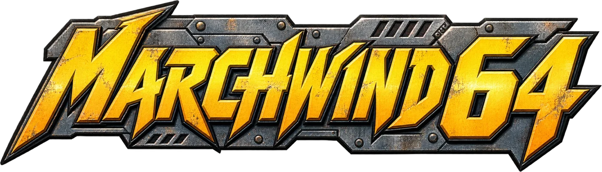
</p>

<p align="center"><b>슈퍼로봇대전64 — 1999년 N64 게임의 네이티브 리컴파일 버전.</b></p>

<p align="center">
  <a href="README.md">English</a> · <a href="README.zh-Hans.md">简体中文</a> · <a href="README.ja.md">日本語</a> · 한국어
</p>

<p align="center">
  <a href="https://srw64.dreamquest.club/ko/">웹사이트</a> ·
  <a href="https://srw64.dreamquest.club/ko/install/">다운로드와 설치</a> ·
  <a href="https://srw64.dreamquest.club/ko/faq/">자주 묻는 질문</a> ·
  <a href="https://srw64.dreamquest.club/ko/story/">시나리오</a> ·
  <a href="https://srw64.dreamquest.club/ko/library/">도감</a> ·
  <a href="https://srw64.dreamquest.club/ko/guide/">공략</a>
</p>

Marchwind 64는 『슈퍼로봇대전64』의 비공식 네이티브 리컴파일 프로젝트입니다.
Windows, macOS, Linux, Steam Deck, Android, Nintendo Switch에서 네이티브로 실행되며,
한국어, 영어, 중국어 전문 번역과 와이드 화면을 지원합니다. 별도의 HD 팩도 선택해서 쓸 수 있습니다.

한국어 번역과 한국어 타이틀 로고: [테오(jung5441)](https://github.com/jung5441), CC BY 4.0.

> **일본판 ROM을 직접 준비해야 합니다** (スーパーロボット大戦64, Rev 0). 이 저장소와
> 다운로드 파일에는 게임 데이터가 들어 있지 않습니다.
> [ROM 안내](https://srw64.dreamquest.club/ko/faq/#rom)를 참고하세요.

| 네이티브 실행 | 한 · 영 · 중 · 일 | HD와 와이드 화면 | 원작 버그 수정 |
| --- | --- | --- | --- |
| 설치하고 ROM을 추가하면 바로 플레이 | 전문 번역 지원, 게임 중 전환 가능 | 원본과 HD 그래픽을 언제든 전환 | 기본으로 켜져 있으며 항목별로 전환 가능 |

## 원본과 HD 그래픽

| 원본 · 4:3 | MARCHWIND 64 · HD 와이드 |
| --- | --- |
| 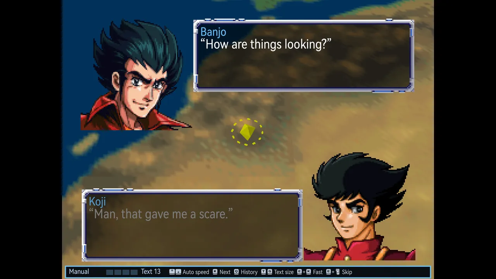 | 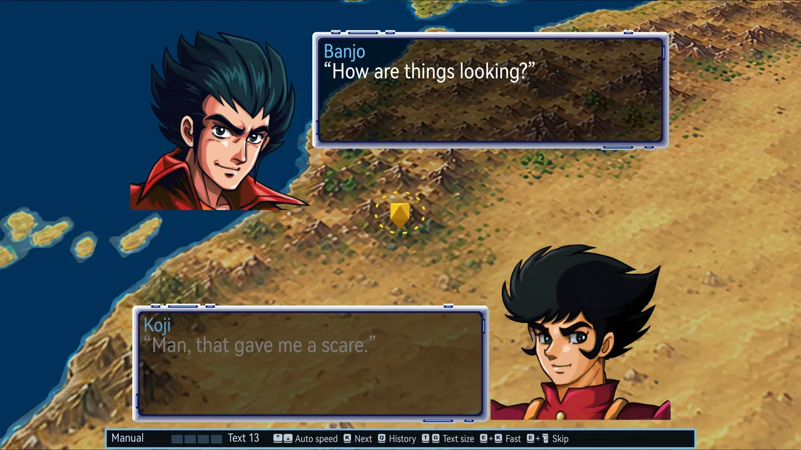 |

왼쪽은 원본 4:3 화면으로, 얼굴 그래픽과 맵이 N64 해상도입니다. 오른쪽은 HD 팩을 적용한
Marchwind 64로, 새로 그린 얼굴 그래픽과 월드맵을 16:9로 보여 줍니다. 게임 중 언제든 원본과
HD 그래픽을 전환할 수 있으며, 세이브는 공통입니다.

## 화면과 조작 개선

N64 원작을 바탕으로 화면을 새로 만들고 전문 번역과 조작 개선을 더했으며, 버그 수정은
항목별로 고를 수 있습니다. 아래 이미지는 모두 게임 내 스크린샷입니다.

### 대사 읽기

| | |
| --- | --- |
| 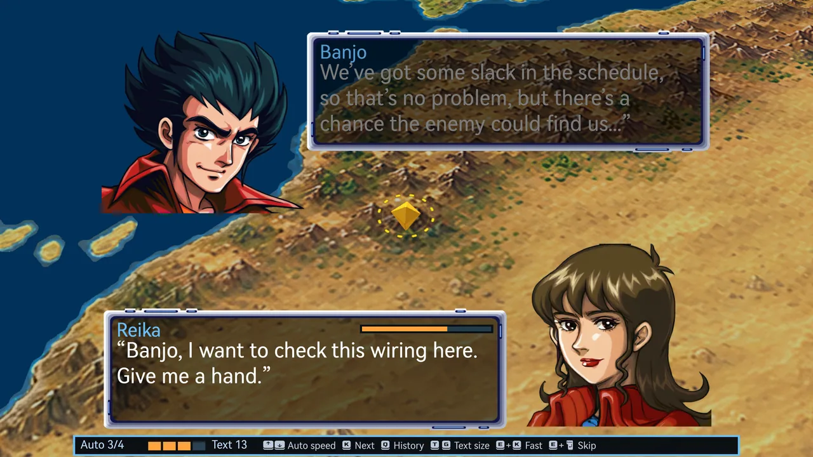 | 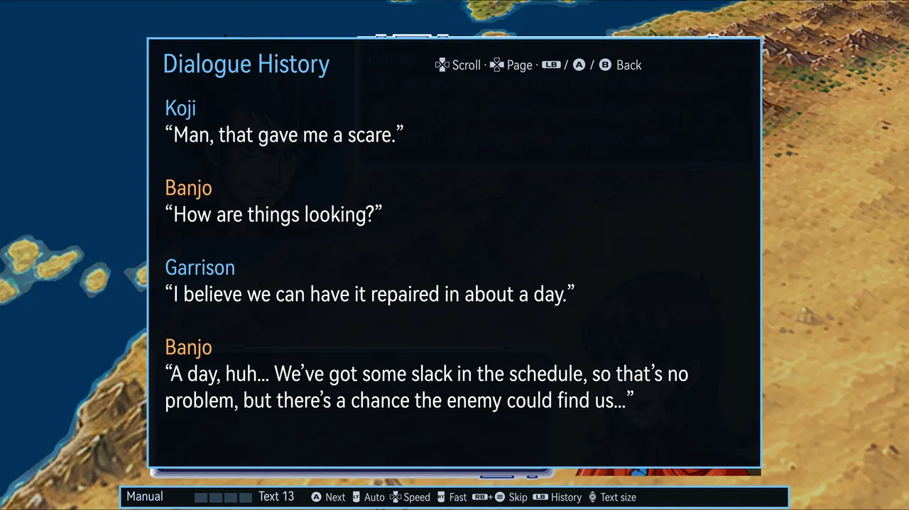 |

모든 대사를 고해상도 글꼴로 다시 조판했습니다. 대사는 끊김 없이 이어서 배치하고 글자
크기에 맞춰 페이지를 나누므로, 문장 중간에서 페이지가 끊기지 않습니다. 지난 대사는 언제든
다시 볼 수 있고, 자동 진행, 빨리 넘기기, 건너뛰기에는 각각 전용 조작이 있으며, 현재 읽기
모드와 조작 방법이 화면 아래에 표시됩니다.

- 최근 256줄의 대사를 화자별 색으로 구분해 다시 볼 수 있습니다
- 자동 진행 속도는 4단계, 글자 크기는 10~18입니다
- 빨리 넘기기와 건너뛰기는 최근 슈퍼로봇대전과 같은 방식입니다. 누르고 있는 동안 빨리
  넘기고 떼면 멈춥니다. 건너뛰기는 다음 선택지나 전투까지 장면 전체를 넘기며, 결과는 모든
  대사를 읽었을 때와 같습니다
- 언어 전환과 일본어 원문 확인은 언제든 할 수 있으며, 표시 중인 대사도 바로 다시
  조판됩니다
- 대사는 직접 고칠 수 있는 일반 텍스트 파일로 저장되어 있습니다

### 최근 슈퍼로봇대전 스타일의 화면과 조작

| | |
| --- | --- |
| 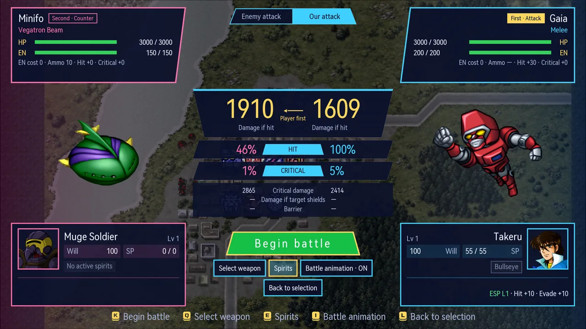 | 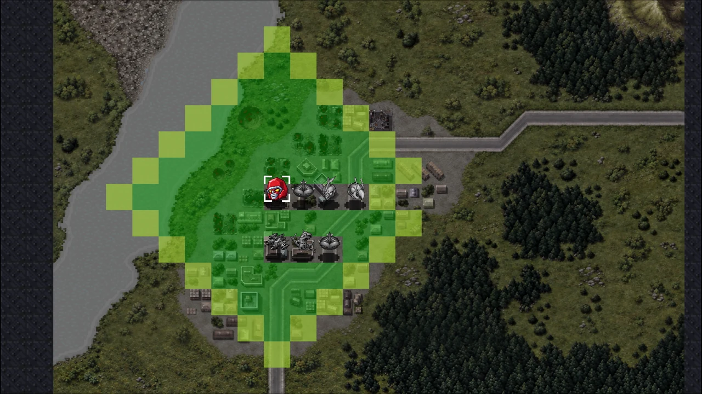 |

전투 준비 화면을 최근 슈퍼로봇대전 시리즈 스타일로 새로 만들었습니다. 양측의 피해량,
명중률, 크리티컬 확률을 실드 방어와 배리어 효과와 함께 나란히 보여 주고, 정신기, 무기
선택, 전투 애니메이션 전환은 아래에 모았습니다. 전술맵에도 최근 작품에 있는 편리한 조작을
더했습니다.

- 이동할 곳을 고를 때 이동 범위의 가장 먼 칸으로 바로 옮길 수 있습니다
- L1/R1로 아군, L2/R2로 적 기체를 차례로 확인할 수 있습니다
- 전투 애니메이션은 언제든 중단할 수 있으며, 전투 결과는 정상적으로 계산됩니다
- 설정에서 원본 화면도 고를 수 있습니다

### 모드: 음악, 수치, 이름, 아이콘

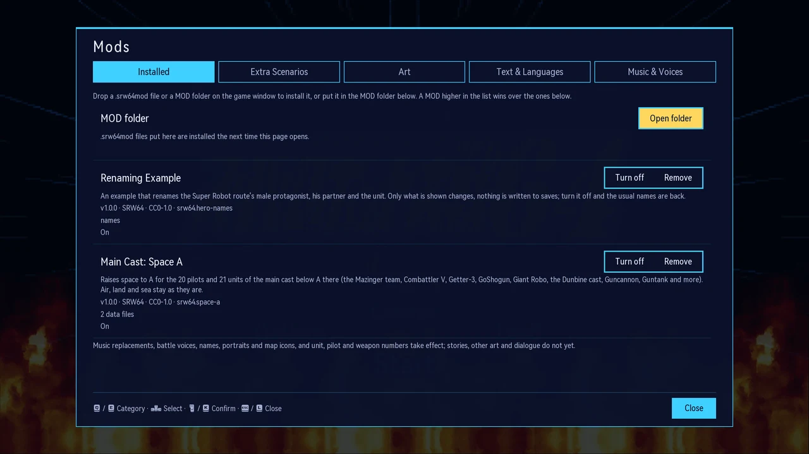

.srw64mod 파일을 게임 창에 끌어다 놓으면 설치됩니다. Android에서는 “파일” 앱의 Marchwind64
폴더 안 mods/에 넣습니다. 패키지에는 코드 없이 데이터만 들어 있고 세이브에는 게임 본래의 값이
남으므로, 언제든 모드를 끄거나 지울 수 있습니다.

- 음악: 49곡 중 원하는 곡을 Ogg 파일로 바꾸고, 캐릭터나 기체별 전투 음악도 지정할 수 있습니다
- 수치: 기체, 파일럿, 무기의 능력치, 지형 적응, 특수 기능, 정신기
- 이름과 얼굴 그래픽: 주인공, 파트너, 부대의 이름, 모든 캐릭터, 기체, 무기의 이름과 캐릭터 얼굴
  그래픽
- 맵 아이콘과 전투 음성: 그림 한 장으로 기체의 맵 아이콘을 바꾸고, 전투 대사가 나올 때 음성을
  재생합니다
- [웹사이트](https://srw64.dreamquest.club/ko/mods/)의 제작 도구 5종으로 모든 작업을 브라우저
  안에서 끝낼 수 있으며, 아무것도 업로드되지 않습니다

### 최대 4배속

| | |
| --- | --- |
| 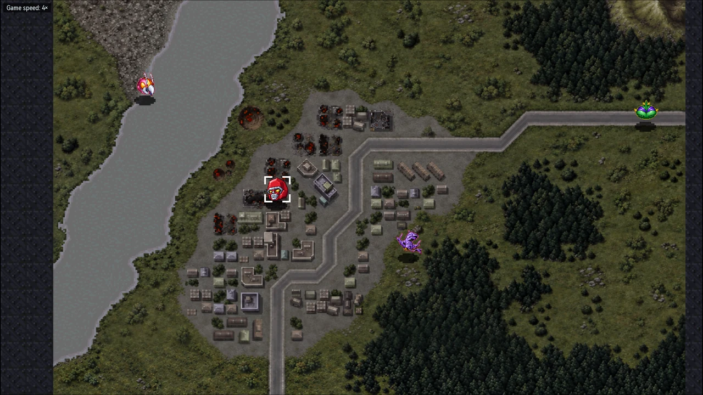 | 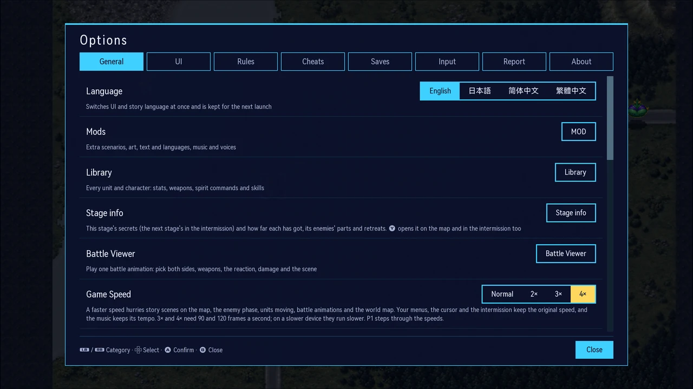 |

속도 키로 보통, 2배속, 3배속, 4배속을 차례로 바꿉니다. 키보드는 Tab, Steam Deck은 뒷면의 R4,
스마트폰은 배속 버튼을 쓰며, 옵션 → 일반에서 직접 고를 수도 있습니다. 맵 위의 스토리 장면, 적
페이즈, 기체 이동, 전투 애니메이션, 월드맵이 빨라지고, 아군 메뉴, 커서, 인터미션은 원래 속도를
유지하며 음악의 음높이도 바뀌지 않습니다.

- 3배속과 4배속에는 초당 90, 120프레임이 필요합니다. 따라가지 못하는 기기에서는 한 프레임씩
  건너뛰어 그리지만, 게임 처리는 매 프레임 진행됩니다
- 노래방 모드, 타이틀 데모, 전투 뷰어는 항상 보통 속도로 실행됩니다

### 게임보이 카트리지 없는 링크 배틀러 연동

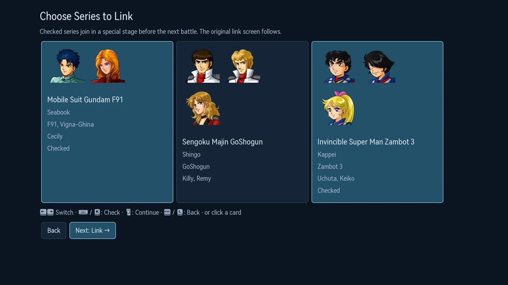

인터미션 메뉴에서 링크를 고르고 작품을 체크하면 F91, 고쇼군, 점보트 3가 원작의 링크 스테이지를
통해 합류합니다. 64GB 팩이나 게임보이 카트리지는 필요 없습니다.

- 처음부터 끝까지 동작을 확인했습니다
- 세 작품을 자유롭게 조합할 수 있습니다

### 게임 내 설정

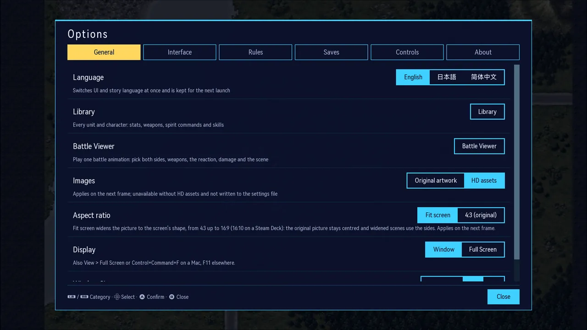

플레이 중에 언어, 원본/HD 그래픽, 화면 비율, 전체 화면, 인터페이스 크기를 바꿀 수
있습니다. 규칙 수정을 항목별로 켜고 끄거나 키보드와 게임패드 조작을 다시 배정할 수도
있습니다.

- 게임 중 언제든, 또는 타이틀 화면 오른쪽 아래 버튼으로 열 수 있습니다
- 인터페이스 크기는 보통, 크게, 가장 크게의 3단계입니다

### RetroArch 필터와 테두리

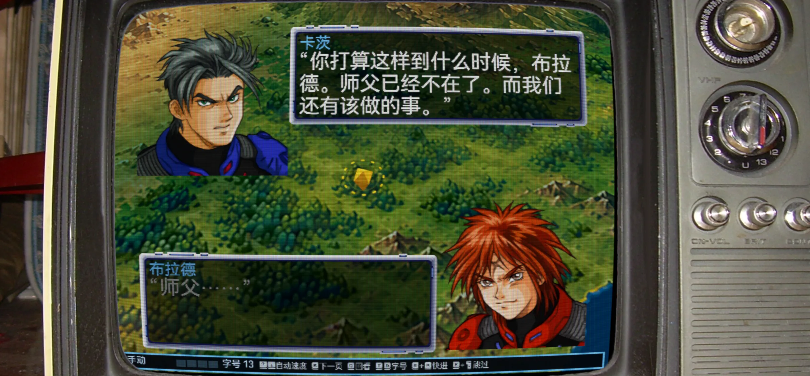

RetroArch의 slang 셰이더 프리셋(.slangp)을 그대로 사용해 CRT 주사선, NTSC 색감 등을 더할
수 있습니다. 4:3 화면에서는 RetroArch 테두리(베젤)도 씌울 수 있으며, 테두리의 투명한 창이
알아서 게임 화면에 맞춰집니다. 두 기능 모두 옵션 → 일반에 있습니다.

- crt-lottes, crt-geom, zfast-crt(휴대용 기기용), ntsc-adaptive, xbrz-freescale 등 자주
  쓰는 프리셋 9종을 기본 제공합니다
- 설치된 RetroArch의 slang 셰이더를 모두 찾아 주며, 직접 준비한 프리셋과 테두리는 데이터
  폴더에 넣으면 됩니다
- 원본 240라인(CRT에 가장 가까움), 480라인, 960라인 또는 창 해상도에서 처리합니다
- 필터는 게임 화면과 대사에만 적용되고, 설정 창, 알림, 테두리는 선명하게 유지됩니다
- 필터는 Windows, macOS, Linux/Steam Deck, Android에서 동작하며, Switch는 아직 지원하지
  않습니다

<sub>테두리: RetroArch 자체 오버레이의 tv-integer(libretro/common-overlays, CC BY 4.0).
필터: crt-lottes, 480라인. 게임에는 테두리가 포함되어 있지 않습니다.</sub>

### 도감: 기체 353종, 인물 293명

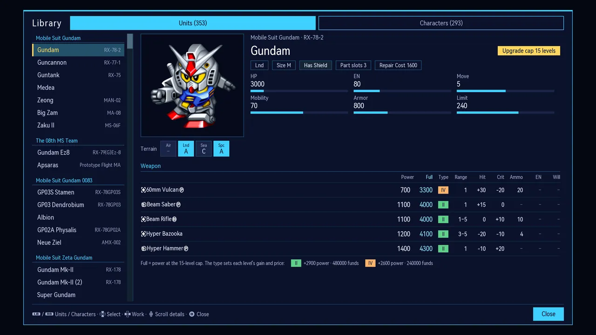

작품별로 기체의 능력치, 지형 적응, 무기와 풀개조 시 위력, 개조 상한, 파일럿의 성장,
정신기, 특수 기능을 정리했습니다. 모든 항목은 게임 데이터에서 직접 가져왔습니다.

- 타이틀 화면에서도, 플레이 중에도 열 수 있습니다
- 같은 [도감](https://srw64.dreamquest.club/ko/library/)을 웹사이트에서도 볼 수 있습니다

### 전투 뷰어

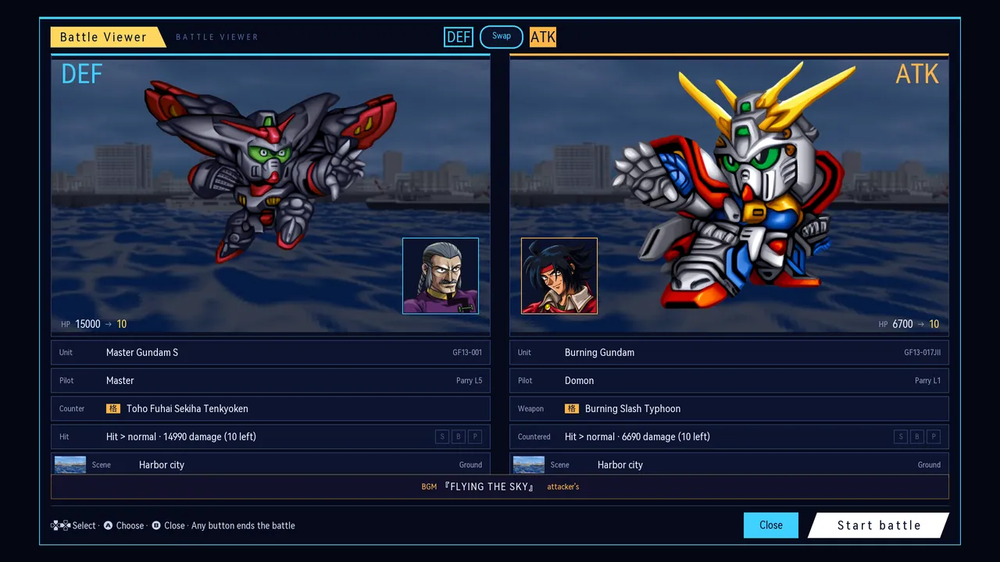

공격 측과 방어 측의 기체와 파일럿을 고르고, 무기, 방어 측의 대응, 피해량, 배경을 정한 뒤
전투 애니메이션을 처음부터 끝까지 재생합니다.

- 모든 기체의 무기 연출을 볼 수 있습니다
- 원작처럼 공격 측의 테마곡이 재생됩니다

## HD 전투 화면

기체, 컷인, 얼굴 그래픽, 배경에 고해상도 그래픽을 쓰면서, 연출 타이밍과 카메라 워크는 원작
그대로입니다.

| | |
| --- | --- |
| 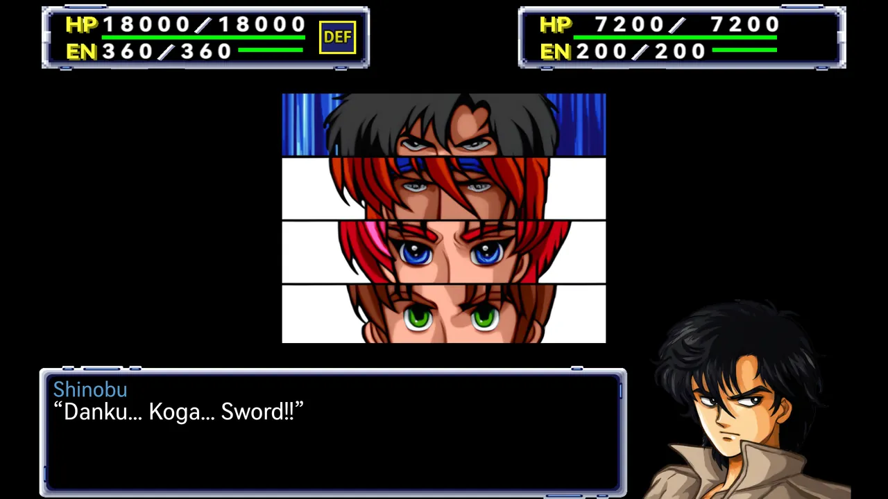 | 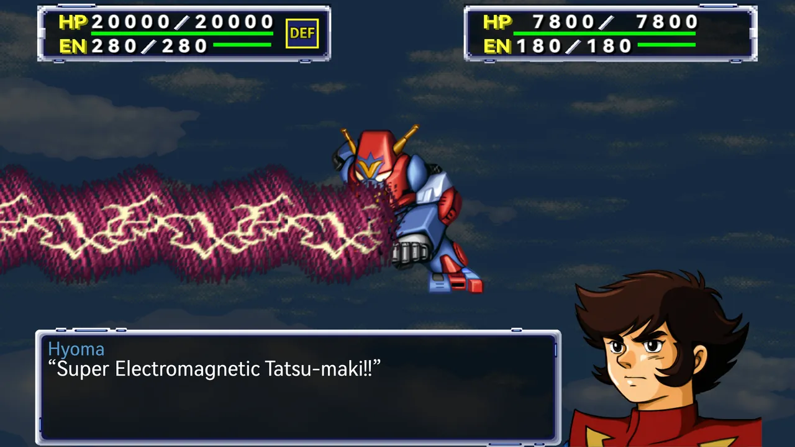 |
| 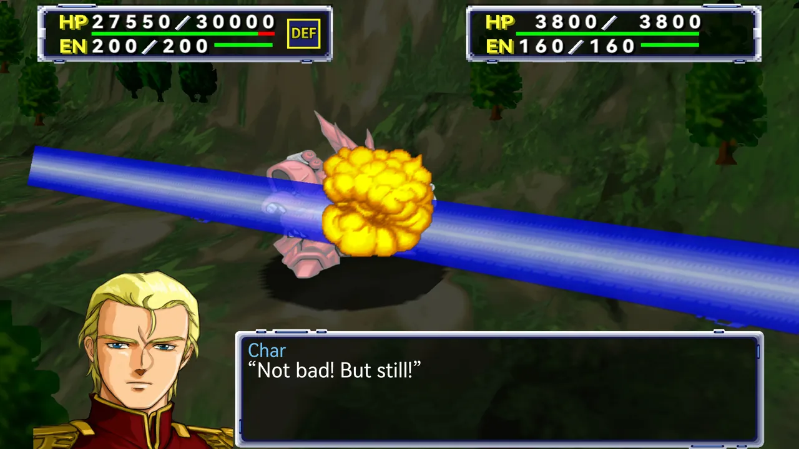 | 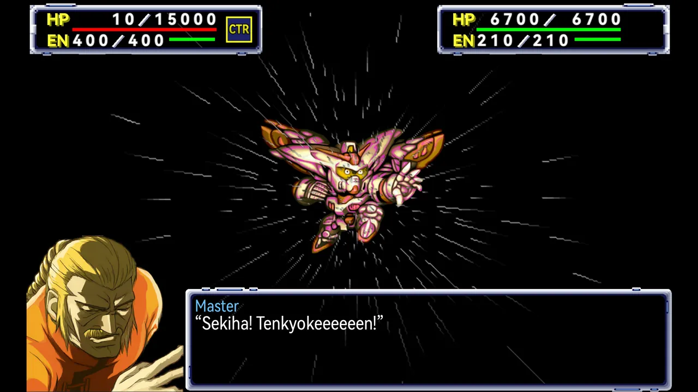 |

## 버그 수정과 선택 규칙

각 규칙은 따로 켜고 끌 수 있고 바로 적용되며, 세이브 형식은 같습니다. “전부 끄기”를 고르면
원작 규칙으로 플레이할 수 있습니다.

**원작 버그 수정** — 기본 켜짐. 원작의 계산 오류와 누락을 바로잡습니다.

- 초능력: 명중과 회피에 실제 기능 레벨을 반영합니다(원작은 항상 64로 계산)
- 성전사: 회피에 실제 레벨을 반영합니다(원작은 항상 32로 계산)
- 한계 반응: 명중과 회피에 각각 운동성을 더한 값을 기체의 한계 수치로 제한합니다
- 저력: HP 구간을 바로잡았으며, HP가 가득 차 있으면 보정이 없습니다
- 저력: 명중과 회피 보정을 절반으로 줄입니다(크리티컬은 그대로)
- 기체 교체: 표에서 빠져 있던 무기 3종도 개조 단계를 계승합니다
- 성전사: 하이퍼 오라 베기의 위력이 레벨에 따라 올라갑니다

**편의성과 난이도** — 기본 꺼짐. 개조, 자금, 전투 난이도를 원하는 대로 조정합니다.

- 개조 제한 완화: 모든 기체를 15단계까지 개조할 수 있습니다
- 이탈 환급: 스토리에서 기체가 이탈하면 개조 자금을 돌려받습니다
- 파츠 계승: 강화파츠가 파일럿과 함께 새 기체로 옮겨집니다
- 보스 더미: 횟수를 절반으로 줄이거나 없앱니다
- 회차 계승: 이전 회차에서 달성한 숨겨진 요소는 원래 합류하는 스테이지 직후에 바로
  합류합니다

**화면과 인터페이스** — 새 UI 또는 원본. 화면마다 새 UI와 원본 중에서 고를 수 있습니다.

- 전투 UI: 새 UI, HD 원본, 원본 중에서 선택
- 인터미션, 주인공 선택, 타이틀 메뉴: 새 UI 또는 원본
- 그래픽: HD 또는 원본, 언제든 전환
- 화면 비율: 화면에 맞춤 또는 4:3 유지
- 무기 개조: 일괄(기체의 모든 무기가 함께 오르며 총비용은 같음) 또는 개별(원본)
- 전투 애니메이션과 자동 저장: 각각 켜고 끌 수 있음

## 그 밖의 기능

- **네이티브 실행.** N64 프로그램을 네이티브 코드로 리컴파일하고, 그래픽은 RT64로
  렌더링합니다. 설치한 뒤 안내에 따라 ROM을 추가하면 바로 플레이할 수 있습니다.
- **5개 언어 전문 지원.** 일본어 원문과 함께 한국어, 영어, 간체 중국어, 번체 중국어 전문
  번역을 수록했습니다. 한국어 번역은 테오(jung5441)의 작업입니다. 캐릭터, 기체, 무기 이름은
  각 언어에서 널리 쓰이는 표기를 따릅니다.
- **세이브 슬롯 추가와 자동 저장.** 원작보다 많은 세이브 슬롯을 제공하고, 주요 시점마다
  자동 저장합니다. 카트리지 세이브는 ares, Project64, RetroArch 등 에뮬레이터에서 쓸 수
  있도록 내보낼 수 있습니다.
- **늘이지 않는 와이드 화면.** 4:3부터 16:9까지의 화면 비율을 지원합니다. 원래 화면은
  가운데에 두고 좌우로 배경을 넓혀, 이미지를 늘이지 않고 화면을 채웁니다.
- **휴대용 기기, 스마트폰, 게임패드.** Steam Deck을 자동으로 인식해 Deck에 맞는 버튼
  배치와 큰 인터페이스를 기본으로 씁니다. Android에서는 현재 화면에 필요한 터치 버튼만
  “확인”, “빨리 넘기기”, “다음 아군”처럼 기능 이름을 붙여 표시합니다.
- **HD 팩(선택).** HD 팩은 따로 내려받으며, 컴퓨터와 Android용 하나와 Switch 전용 팩이
  있습니다. 설치하지 않으면 원본 도트 그래픽으로 표시되고, 설치한 뒤에는 게임 중 언제든
  둘을 전환할 수 있습니다.

## 시스템 요구 사항

Windows, Steam Deck, Android, Switch는 실험적입니다. 컴퓨터의 그래픽 요구 사항은
[RT64](https://github.com/rt64/rt64)로 렌더링하는 다른 리컴파일 작품과 같으며, 이보다
오래된 하드웨어는 테스트하지 않았습니다.

### Windows(실험적)

설정과 세이브를 게임과 함께 두려면 EXE 옆에 `user-data` 폴더를 만드세요. 이 폴더의
데이터가 우선하며, 정상적으로 종료하면 AppData로 다시 복사해 둡니다. 세이브가 다르면
먼저 묻고 백업한 뒤 바꿉니다. 이 폴더가 없으면 기존의 AppData 동작 그대로입니다.
[데스크톱 포터블 데이터](docs/guide/desktop-portable.md)를 참고하세요.

| | 요구 사항 |
| --- | --- |
| OS | Windows 10 / 11, 64비트 |
| 그래픽 | Direct3D 12(Shader Model 6.0) 또는 Vulkan 1.2 |
| NVIDIA | GeForce GT 630(Kepler) 이상 |
| AMD | Radeon HD 7750 이상 |
| Intel | Intel HD Graphics 510(6세대 Core) 이상 |
| CPU | x86-64-v2 프로세서(1세대 Intel Core i, AMD FX 이상) |
| 드라이버 | 최신 그래픽 드라이버 |

### macOS

| | 요구 사항 |
| --- | --- |
| OS | macOS 14 이상 |
| 프로세서 | Apple 실리콘(M1 이상). Intel Mac은 지원하지 않습니다 |
| 그래픽 | Metal |

### Linux

Windows와 마찬가지로 `srw64` 옆에 `user-data` 폴더가 있으면 포터블 설정과 세이브를
쓰며, 정상적으로 종료할 때 확인과 백업을 거쳐 시스템 사용자 디렉터리와 동기화합니다.
[데스크톱 포터블 데이터](docs/guide/desktop-portable.md)를 참고하세요.

| | 요구 사항 |
| --- | --- |
| OS | 64비트, glibc 2.35 이상(Ubuntu 22.04, Debian 12 이상) |
| 그래픽 | Vulkan 1.2 |
| GPU와 CPU | Windows와 같음 |
| 드라이버 | 최신 Mesa 또는 NVIDIA 드라이버 |

### Steam Deck(실험적)

최신 SteamOS의 LCD, OLED 모델. Linux 패키지를 쓰며, 스크립트로 Steam에 추가한 뒤 게임
모드에서 실행합니다.

### Android(실험적)

| | 요구 사항 |
| --- | --- |
| OS | Android 9 이상 |
| 프로세서 | arm64(64비트) |
| 그래픽 | Vulkan 1.1 |
| 권장 | Snapdragon 865, Dimensity 1080, Exynos 1380, Tensor G2 이상, 약 30 FPS |
| 보급형 | Dimensity 6100+, Dimensity 700 등(Mali-G57)은 약 10~14 FPS |

### Nintendo Switch(실험적)

| | 요구 사항 |
| --- | --- |
| 본체 | Atmosphère 커스텀 펌웨어를 실행할 수 있는 Switch(초기 모델에서 테스트) |
| 시스템 | Atmosphère와 hbmenu, 애플리케이션 모드(R을 누른 채 게임 실행) |
| 용량 | SD 카드에 약 150 MB, Switch용 HD 팩은 약 1.3 GB 추가 |

SD 카드의 루트에 압축을 풀고 ROM을 `/switch/Marchwind64/`에 `rom.z64`라는 이름으로
넣으세요. 처음 실행할 때 본체에서 30초쯤 걸려 가져옵니다. NRO 홈브루 프로그램이며 NSP는
없습니다. 컴퓨터용 HD 팩은 Switch에서 쓸 수 없습니다.

게임은 약 150 MB, 선택 사항인 HD 팩은 약 550 MB를 더 차지합니다. 실행하자마자 꺼지거나
멈추면 먼저 그래픽 드라이버를 업데이트하세요. 플랫폼별 설치 방법은
[설치 페이지](https://srw64.dreamquest.club/ko/install/)에 있습니다.

## 번역 개선에 참여하기

[화수별 전체 시나리오](https://srw64.dreamquest.club/ko/story/)에서 일본어 원문과 번역을
나란히 읽을 수 있습니다. 어색한 문장이나 일관되지 않은 이름은 해당 줄에 수정을 제안해
주세요. 각 제안의 처리 결과는 공개됩니다. 버그는
[GitHub Issues](https://github.com/dyzz/srw64-recomp/issues)에 올려 주세요.

## 소스에서 빌드하기

저장소에는 ROM, 세이브, 추출한 게임 데이터, 생성된 게임 코드, HD 그래픽, 빌드된 앱이 들어
있지 않습니다. 직접 준비한 일본판 Rev 0 ROM을 저장소 루트에 `rom.z64`라는 이름으로
두세요(식별 정보는 [출처 기록](docs/guide/provenance.md)에 있습니다).

macOS(Apple 실리콘)에서 Python 3.11 이상과 Xcode 명령줄 도구를 준비한 뒤:

```sh
brew install python cmake ninja sdl2 freetype harfbuzz icu4c
make                                                  # 툴체인, 생성된 게임 코드, 호스트
scripts/Play\ SRW64\ Native.command --language ko     # 플레이
```

- [개발 안내](docs/guide/native-development.md): 빌드 순서, 검사, 모듈 경계
- [Linux와 Steam Deck 빌드](docs/guide/linux-build.md) · [릴리스](docs/guide/release.md)
- [디버그 인터페이스와 MCP](docs/guide/debug-interface.md): 명령줄이나 AI 에이전트로 게임 조작
- [기술 문서 목록](docs/README.md)(대부분 중국어) · [기여하기](CONTRIBUTING.md)

## 크레딧

[N64Recomp](https://github.com/N64Recomp/N64Recomp),
[N64ModernRuntime](https://github.com/N64Recomp/N64ModernRuntime),
[RT64](https://github.com/rt64/rt64)를 바탕으로 만들었습니다. 그 밖의 출처와 고정한
리비전은 [출처 기록](docs/guide/provenance.md)에 있습니다. 인터페이스와 대사에는 HarmonyOS
Sans 글꼴을 라이선스에 따라 수정 없이 동봉했고(`content/fonts`), 버튼 아이콘은 Yukari
“Shinmera” Hafner의 PromptFont를 SIL Open Font License에 따라 고쳐 썼습니다.
한국어 번역과 한국어 타이틀 로고는 [테오(jung5441)](https://github.com/jung5441)의
작업이며, [CC BY 4.0](https://creativecommons.org/licenses/by/4.0/)으로 제공됩니다. 한국어
글자에는 Droid Sans Fallback(Apache License 2.0)과 Nanum Brush Script, Gmarket Sans의
서브셋(SIL Open Font License, SRW64 Brush KO와 SRW64 Banner KO로 이름을 바꿈)을 씁니다.

이 프로젝트는 비공식 팬 프로젝트입니다. 슈퍼로봇대전과 관련된 모든 캐릭터, 기체, 상표는 각
권리자에게 속합니다.

## 라이선스

이 프로젝트가 직접 작성한 소스 코드와 도구는
[GNU General Public License v3.0](LICENSE) 또는 (원한다면) 그 이후 버전으로
제공됩니다. 이는 프로젝트가 작성한 부분에만 적용되며, 슈퍼로봇대전64와 그 ROM, 거기에서
가져오거나 파생한 것(게임 코드, 텍스트, 데이터, 이미지, 음악)과 권리자의 캐릭터, 기체,
상표에는 적용되지 않습니다. `content/fonts`의 글꼴, HD 이미지 팩(NOTICE 참고), 서드파티
구성 요소는 각자의 조건을 따릅니다.
